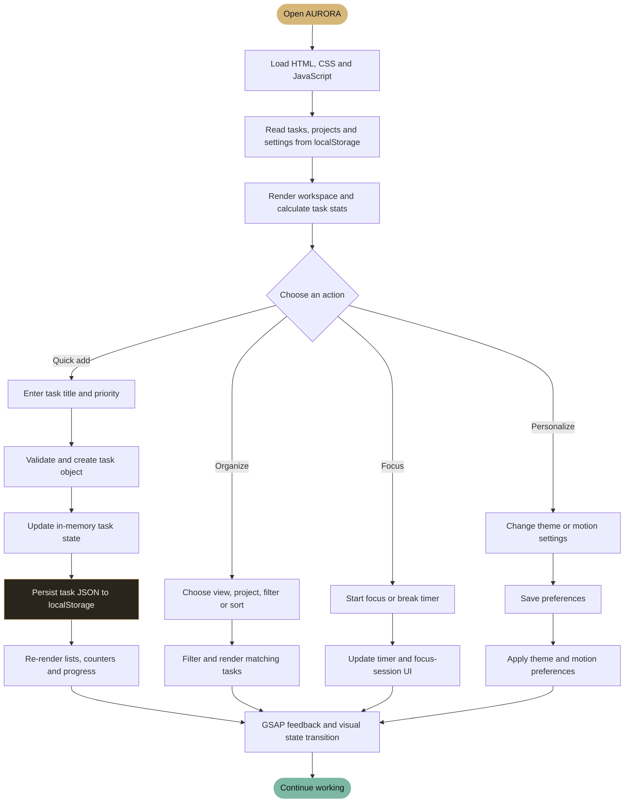
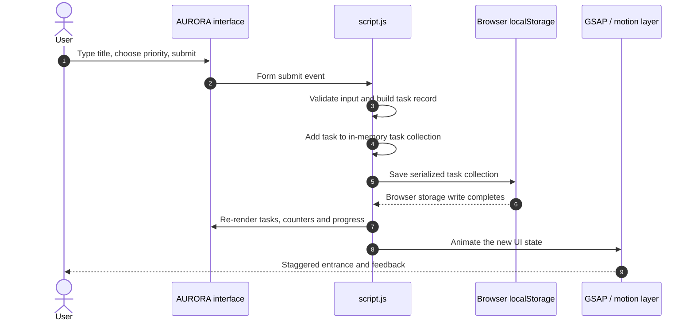
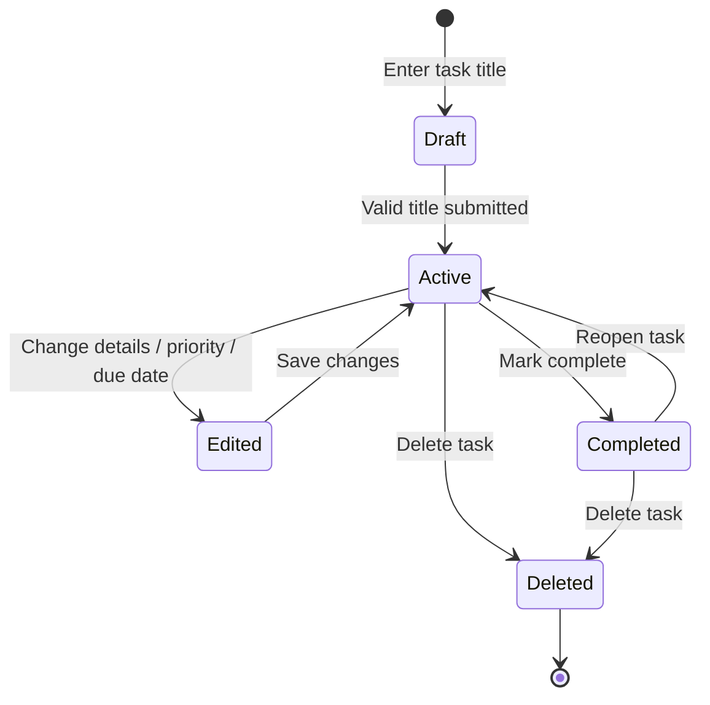
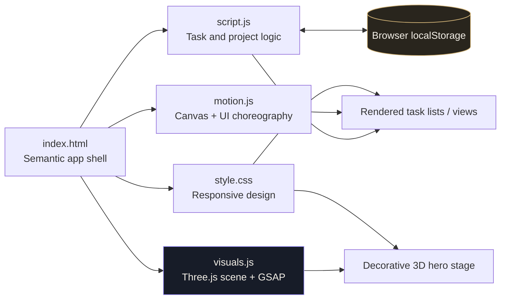

<!--
  AURORA / MOTION ATLAS
  README designed for GitHub's supported rendering: animated hosted SVGs,
  badges, tables, Mermaid workflow diagrams, and accessible documentation.
-->

<div align="center">


<p>
  <strong>A motion-rich, local-first productivity workspace.</strong><br/>
  Glassmorphism · GSAP choreography · Real-time 3D · Focus sessions · Thoughtful task management
</p>

<p>
  <a href="https://github.com/SanFlash/to-do-list.com"></a>
  
  
  
  
</p>

<a href="#-real-application-flow">Explore the real application flow ↓</a>

</div>

---

## ◈ A productivity app that feels alive

AURORA is a responsive task and focus workspace built with **HTML, CSS, and vanilla JavaScript**, with **GSAP** for interface choreography and **Three.js** for a real-time 3D hero scene.

The design uses deep obsidian surfaces, warm champagne highlights, translucent panels, ambient particles, orbiting geometry, soft light, and small motion details. The visual ambition is high; the interaction cost should stay low.

> **Design rule:** motion should clarify a state, guide attention, or reward an action — never make a task harder to finish.

## ✦ The motion experience

<div align="center">


| ◌ AMBIENCE | ◈ 3D SCENE | ✧ MICRO-INTERACTIONS |
|:---:|:---:|:---:|
|  |  |  |
| Canvas particles, ambient glow, grain, and layered orbital rings | Three.js geometry, wireframe shells, moving lights, dust, and pointer parallax | Staggered entrances, button sheen, card response, toast transitions, and view changes |


</div>

### Animation layers

- **Atmosphere:** CSS glow fields, grain, and orbital details create depth behind the workspace.
- **3D hero:** a Three.js scene renders a faceted crystal, wireframe shells, inner geometry, orbital rings, particles, and animated lights.
- **GSAP choreography:** entrance sequences, staggered task rows, toast feedback, and ambient motion make UI state changes feel deliberate.
- **Pointer response:** the hero scene subtly reacts to pointer movement on supported desktop devices.
- **Responsive motion:** visual density and rendering cost are reduced for smaller screens.
- **Motion safety:** reduced-motion preferences disable or calm non-essential animation; the 3D scene is decorative, not required to use the app.

> GitHub README files do not run arbitrary embedded JavaScript or GSAP timelines. The moving header and typing text above are hosted animated SVGs; the Mermaid diagrams below describe the **actual app workflow**, while the live animations run inside the application itself.

---

## 🚦 Real application flow

This is the practical journey from opening AURORA to completing and saving a task. The app currently runs in the browser and uses local storage; it does **not** send tasks to a server.

### 1. User journey — from intention to completion



### 2. What happens when a task is created?



### 3. The real task lifecycle



**Data flow at a glance**

| Stage | Responsibility | Current implementation |
|---|---|---|
| Input | Capture task title and task details | HTML forms and controls |
| State | Keep the current task/project/settings collections | JavaScript in-memory state |
| Persistence | Save and reload between browser visits | Browser `localStorage` |
| Presentation | Render views, task cards, filters, and counters | DOM updates in `script.js` |
| Motion | Animate entrances and feedback | GSAP in `motion.js` and app interactions |
| 3D ambience | Render the decorative hero sculpture | Three.js + GSAP in `visuals.js` |
| Backup | Export a copy of the workspace data | JSON export from Settings |

---

## ⚡ What you can do in the app

| Workspace area | Current capabilities |
|---|---|
| **Tasks** | Create, edit, complete, reopen, and delete tasks; descriptions, priority, due date, estimates, projects, and subtasks |
| **Views** | My Day, Inbox, Upcoming, All Tasks, project views, filtering, sorting, and task search |
| **Projects** | Create projects with names, descriptions, and accent colours |
| **Focus** | Pomodoro-style focus/break timer and daily focus-minute tracking |
| **Personalization** | Dark/light theme, 3D scene setting, and reduced-motion setting |
| **Command palette** | Open with `Ctrl + K` on Windows/Linux or `Cmd + K` on macOS |
| **Backup** | Export tasks, projects, and settings to JSON |
| **Responsive UI** | Workspace layouts adapt to desktop and smaller screens |

## 🧭 Architecture — how the pieces connect



### Source map

| File | Responsibility |
|---|---|
| `index.html` | App shell, navigation, views, forms, focus interface, and script entry points |
| `style.css` | Layout, responsive styles, glass surfaces, visual effects, fallbacks, and reduced-motion styles |
| `script.js` | Task state, project state, filters, local persistence, timer, settings, and JSON export |
| `motion.js` | Ambient particle canvas, UI choreography, and motion preference integration |
| `visuals.js` | Three.js scene setup and GSAP-powered 3D animation |
| `.github/workflows/validate.yml` | Static validation and source-wiring checks |
| `vercel.json` | Static deployment configuration |

---

## 🛠️ Run it locally

**Requirements:** Git and Python 3 (for a lightweight local HTTP server). No npm build step is required.

```bash
git clone https://github.com/SanFlash/to-do-list.com.git
cd to-do-list.com
python -m http.server 4173
```

Open [http://localhost:4173](http://localhost:4173).

> Use a local HTTP server instead of opening `index.html` directly. The 3D module imports Three.js and GSAP from jsDelivr, so the browser needs network access to load those dependencies.

### What if the 3D scene cannot load?

The hero includes CSS artwork behind the WebGL stage. If WebGL or the external module fails, the decorative scene may be unavailable, but the core task interface is designed to remain usable. An internet connection is needed for CDN-loaded libraries and remote fonts.

---

## ☁️ Deploy to Vercel

1. Import [`SanFlash/to-do-list.com`](https://github.com/SanFlash/to-do-list.com) into Vercel.
2. Select **Other** as the Framework Preset.
3. Leave the Build Command empty and serve the repository root.
4. Deploy and open the generated URL.
5. Verify task creation, editing, completion, settings, JSON export, and the browser console.

No environment variables are required for this local-first version.

---

## ♿ Motion, performance and accessibility

AURORA uses motion as progressive enhancement. Task completion and navigation must remain usable without the decorative 3D scene.

- Respects the system `prefers-reduced-motion` preference.
- Includes a **Settings → Reduced motion** control for non-essential motion.
- Keeps decorative visual layers out of the accessibility tree and pointer hit-testing.
- Pauses or reduces background work when appropriate, including when the browser tab is hidden.
- Reduces visual density on smaller viewports.
- Keeps the CSS hero artwork as a fallback behind the WebGL scene.

### Manual QA checklist

- [ ] Add a task with each priority.
- [ ] Edit, complete, reopen, and delete tasks.
- [ ] Create a project and move a task into it.
- [ ] Verify filters, sorting, task search, and view navigation.
- [ ] Add and complete subtasks.
- [ ] Reload the page and confirm local data persists.
- [ ] Export JSON and verify the exported file.
- [ ] Change theme and reduced-motion settings.
- [ ] Use the app with reduced motion enabled.
- [ ] Check desktop, tablet, and mobile widths.
- [ ] Test with WebGL unavailable or CDN access blocked.
- [ ] Inspect browser console and Vercel deployment logs.

---

## 🔐 Data storage: important to know

Tasks, projects, settings, and focus totals are stored in the **current browser's local storage**. Data is not automatically synced between devices, browsers, or users. Clearing browser storage can remove the local workspace, so export a JSON backup when needed.

This repository does not currently configure server-backed accounts, cross-device synchronization, cloud database persistence, realtime collaboration, or server-delivered reminders. Those require a backend and appropriate access controls before they can be described as production features.

---

## 🎨 Visual language

<div align="center">

| OBSIDIAN | CHAMPAGNE | IRIS | SAGE |
|:---:|:---:|:---:|:---:|
|  |  |  |  |


</div>

Typography uses Manrope for expressive headings, DM Sans for everyday UI, and DM Mono for compact labels. Translucent panels, thin borders, orbital line art, and warm gradients bring the experience together.

---

## 🧑‍💻 Creator

<div align="center">

**Satyendra Kumar Namdeo**

*Building practical tools with thoughtful UX, automation, and a love for motion design.*

<a href="https://github.com/SanFlash"></a>
<a href="https://github.com/SanFlash/to-do-list.com"></a>


</div>

---

<div align="center">

<sub>BUILT TO CAPTURE THE THOUGHT. DESIGNED TO PROTECT THE FOCUS. ANIMATED TO MAKE PROGRESS FEEL ALIVE.</sub>

</div>
